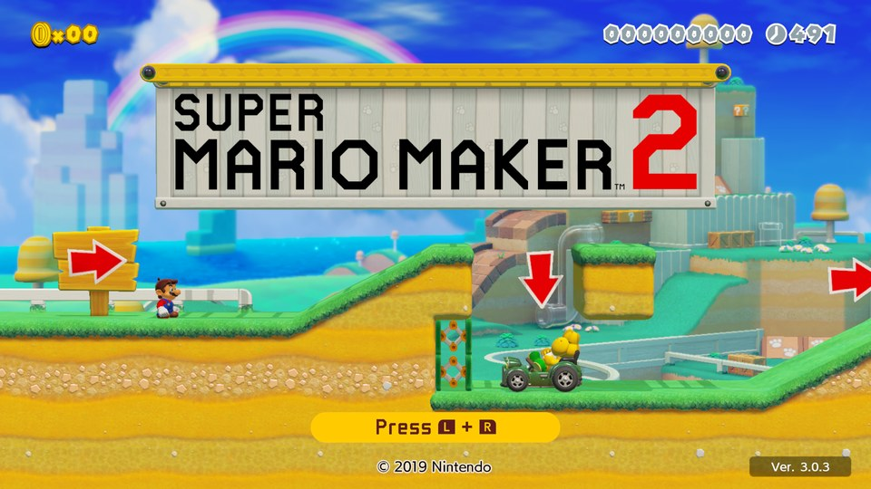
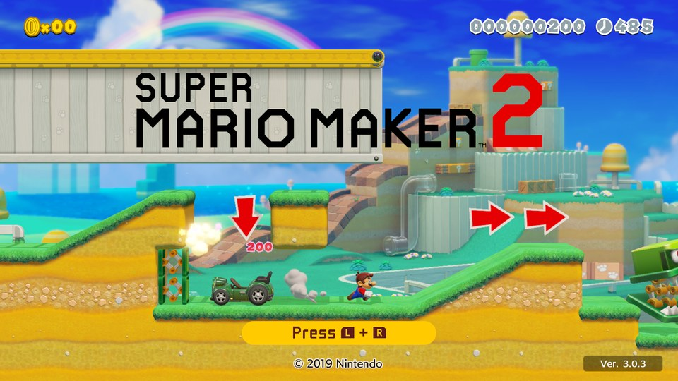
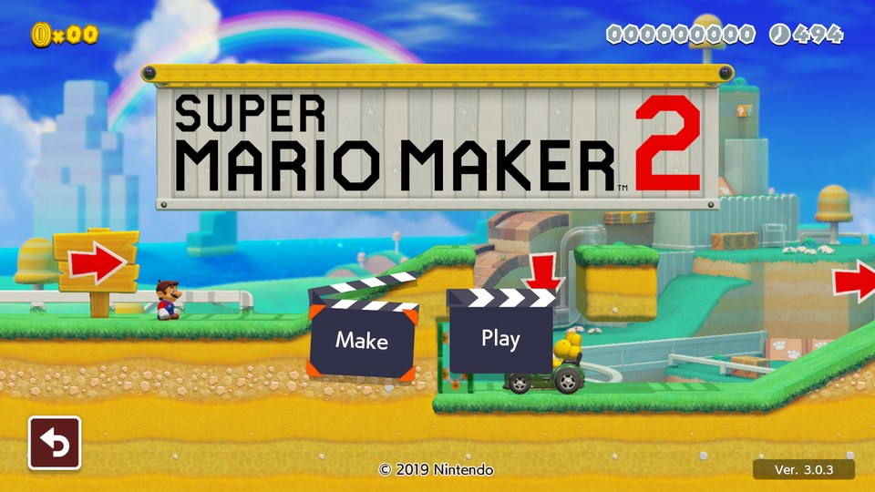
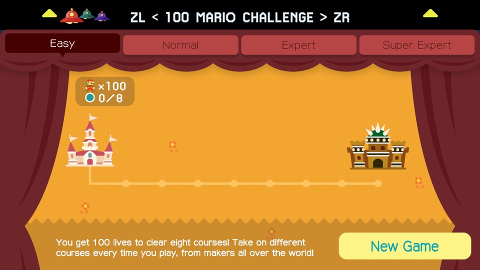
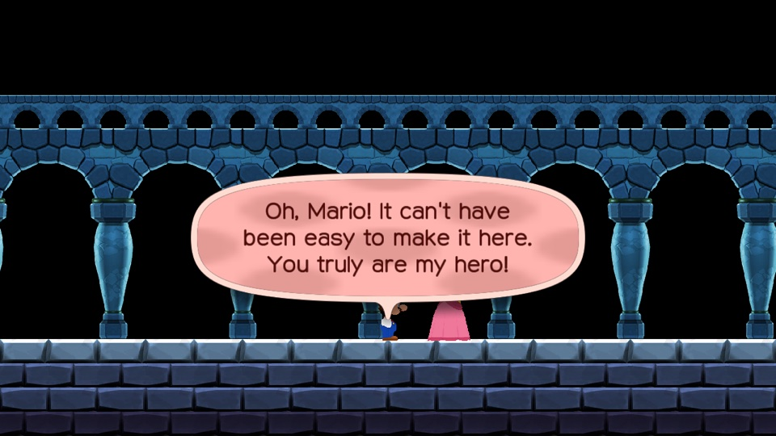
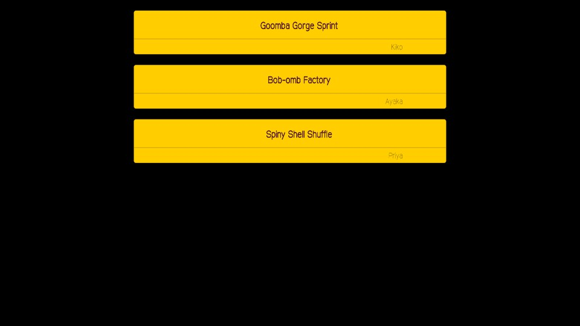

# SMM2 Recomp

A native port of **Super Mario Maker 2** (v3.0.3) for macOS, iOS / iPadOS, Windows, Linux and
Android, made by **static recompilation**. The game's AArch64 code is translated to C ahead of time
and compiled for your platform. A native runtime stands in for the Switch's system services, and
the game's graphics run on Metal or Vulkan. Nothing is emulated at run time.

On top of the original game it adds:

- **The 100 Mario Challenge from Super Mario Maker 1**, with SMM1's difficulty select, world map,
  start card and ending, next to SMM2's own Endless Challenge
- **Course World without Nintendo's servers**, through a self-hostable open-source course server,
  or courses from [TGRCode](https://tgrcode.com/mm2)'s public archive
- **SMM1 features as mods**, each with its own switch (in progress: Mystery Mushroom costumes,
  mid-air shell jumps, overlapping pipes)

> **You need your own copy of the game.** This repository contains no code, assets, text, keys
> or recompiled output from Super Mario Maker 2 or Super Mario Maker. You point the build at your
> own dump, and everything made from it is generated on your machine.

## Screenshots

| Title screen | Playing the title course | Make / Play |
|---|---|---|
|  |  |  |

**100 Mario Challenge**

| Difficulty select | World map | Start card |
|---|---|---|
|  |  |  |

| Ending | Credits |
|---|---|
|  |  |

## Status

**Early development.** Not yet released; you build it yourself from source.

| Platform | Graphics | Status |
|---|---|---|
| **macOS** (Apple Silicon) | Metal | Plays courses. Input replays stay frame-for-frame in sync with the game running in Ryujinx, and in-course frames are pixel-identical in 71 of 90 style × theme combinations. The reference platform. |
| **iOS / iPadOS** (arm64) | Metal | Plays at 60 fps on iPad Pro, with an on-screen controller and touch. Built on a Mac and installed on your own device. |
| **Windows** (x64) | Vulkan | Builds and packages; not yet tested on real hardware. See [docs/windows.md](docs/windows.md). |
| **Linux** (x64, arm64) | Vulkan | Builds and packages; arm64 boots to the title screen in a VM. |
| **Android** (arm64) | Vulkan | In progress: boots to the title screen in the emulator. |

| Feature | Status |
|---|---|
| Title, menus, course play, Course Maker test play | Working; fidelity work ongoing |
| 100 Mario Challenge (SMM1) | Playable start to finish, ending included |
| Endless Challenge (SMM2) | Playable against the course server |
| Course World (lists, search, download, play, leaderboards) | Working against the course server; likes, comments and uploads in progress |
| Edit any course (as in SMM1) | In progress |
| SMM1 feature switches | In progress |
| Online multiplayer | Planned; network groundwork in progress |

[PROGRESS.md](PROGRESS.md) has the detailed checklist and the evidence behind each item, and
[DECISIONS.md](DECISIONS.md) records the design decisions and why they were made.

## How it works

1. **Recompile.** The recompiler (`recomp/tools/`, Python) reads the game's executable from your
   dump and translates every function to C.
2. **Build.** That C is compiled together with the runtime (`recomp/runtime/`, C and
   Objective-C), which implements the Switch's kernel, system services, audio, input and the NVN
   graphics API on Metal or Vulkan.
3. **Play.** The result is an ordinary native app that loads the game's assets straight from your
   dump.

Mods hook into the recompiled game at chosen functions. The course server (`core/`, Rust) answers
the requests the game would normally send to Nintendo.

The recompiler is a fork of [LAS Recomp](https://github.com/peiikai/LASRecomp) (MIT).

## Building

### What you need

- A dump of **Super Mario Maker 2**: the base game RomFS plus the **v3.0.3 update** ExeFS and
  RomFS, extracted
- For the 100 Mario Challenge, a dump of **Super Mario Maker** (Wii U)
- macOS on Apple Silicon with the Xcode command-line tools, Homebrew `sdl3` and `ffmpeg`, and
  Python 3.12 or newer
- About 2 GB of free disk space

### macOS

```sh
make -C recomp venv        # once: the recompiler's Python environment
make -C recomp smm2        # verify the dump, recompile it to C, build (10–20 min the first time)
make -C recomp run-smm2    # play
```

**Controls:** a controller works out of the box. On the keyboard:

| Keys | Switch button |
|---|---|
| WASD | left stick |
| arrow keys | D-pad |
| K / J / L / I | A / B / X / Y |
| Q / E | L / R |
| 1 / 3 | ZL / ZR |
| Enter / Backspace | + / − |
| F1 or Esc | settings menu |
| F11 | full screen |

### Other platforms

- **Windows:** cross-compiled from macOS into a package that recompiles the game from your dump on
  first launch. See [docs/windows.md](docs/windows.md).
- **iOS / iPadOS, Linux, Android:** see [recomp/README.md](recomp/README.md).

## The course server

Course World, the Endless Challenge and the 100 Mario Challenge talk to a self-hostable
open-source server instead of Nintendo's. The server holds accounts, courses, leaderboards and
challenge runs, and can also pull courses from TGRCode's archive. On iOS a copy runs inside the
app, so no setup is needed.

To run your own:

```sh
cd core
cargo run --release -p mmk-cli -- server --dir ./server-data --addr 0.0.0.0:8640
cargo run --release -p mmk-cli -- register Ada --server http://localhost:8640   # prints a token
cargo run --release -p mmk-cli -- upload --token <token> courses/*.bcd --keys <course key table>
```

[docs/self-hosting.md](docs/self-hosting.md) covers ports, HTTPS, accounts and moderation. The API
is documented at the top of `core/crates/server/src/lib.rs`.

## Repository layout

| Path | Contents |
|---|---|
| `recomp/` | the recompiler, the runtime and SMM2's game-specific code and mods ([recomp/README.md](recomp/README.md)) |
| `core/` | the course server and shared course logic (Rust) |
| `smmfmt/`, `tests/` | a Python reference implementation of the course file formats |
| `docs/` | course file formats, toolchain, self-hosting, Windows |

## Contributing

```sh
scripts/install-hooks.sh     # pre-commit check that blocks proprietary files
scripts/check.sh             # everything CI runs: server fmt / clippy / tests, recomp compile check, proprietary-file check
```

Never commit game files or anything generated from them. Generated output stays in the gitignored
`recomp/private/`, `recomp/generated/` and `recomp/build/`. `scripts/check_no_proprietary.py` runs
in CI and in the pre-commit hook to enforce this.

## Legal

This is an unofficial fan project, not affiliated with or endorsed by Nintendo. Super Mario Maker,
Super Mario Maker 2 and related names are trademarks of Nintendo. No Nintendo code or assets are
distributed here. You need a legally obtained copy of the game, and you build everything from it
yourself.
